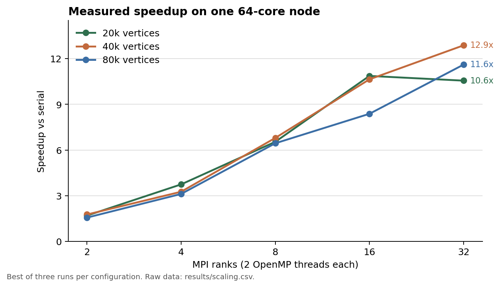
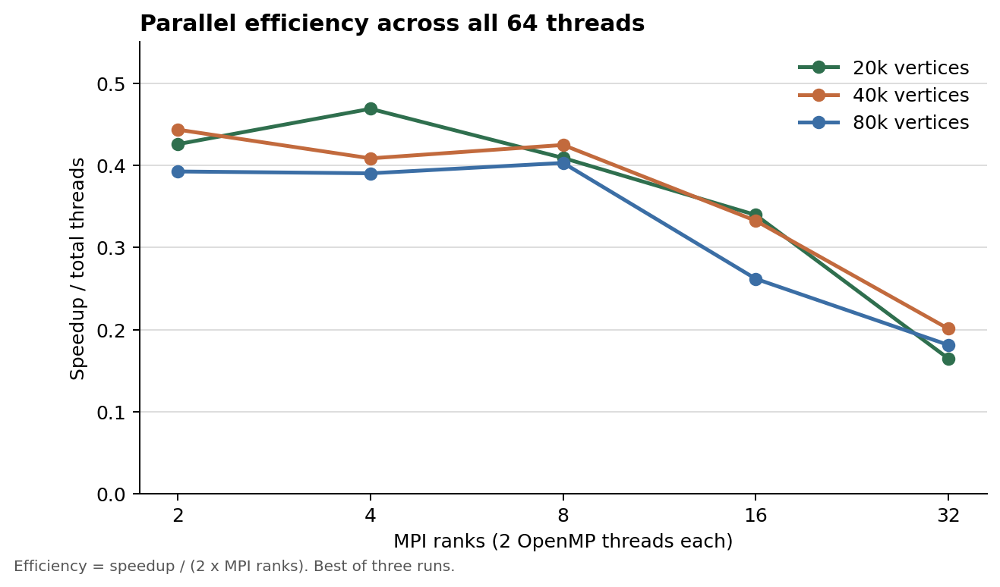

# parallel-mst

Hybrid MPI + OpenMP implementation of Boruvka's minimum spanning tree algorithm for dense
graphs, written in C.

Each MPI rank owns a contiguous block of vertices and scans its rows with OpenMP. The graph is a
flat, 64-byte-aligned symmetric `uint16_t` adjacency matrix, memory-mapped on rank 0 and broadcast
once. Boruvka rounds use `MPI_Allreduce` over per-component minima; union-find with path
compression tracks components.

An earlier optimization pass replaced `fscanf` and per-row broadcasts with `mmap` and a single
bulk broadcast; that input path is what the current code uses. The numbers below time the
computation phase, not graph loading.

## Results

Single 64-core node (AMD EPYC 9334), 2 OpenMP threads per MPI rank, synthetic dense graphs
(approximately `m = n^2 / 4`). Best of three runs:

| Graph | Best speedup | Median speedup | Time at best speedup | Configuration |
|---:|---:|---:|---:|---|
| 20k vertices | **10.87x** | 10.23x | 0.86s | 16 ranks / 32 threads |
| 40k vertices | **12.87x** | 11.80x | 3.53s | 32 ranks / 64 threads |
| 80k vertices | **11.61x** | 9.41x | 23.03s | 32 ranks / 64 threads |

The study covers 2, 4, 8, 16, and 32 MPI ranks. Speedup is relative to the serial implementation
on the same node. The 20k graph stops scaling after 16 ranks; 40k and 80k keep scaling to 32.
Total-thread efficiency falls from about 0.42 at 4 ranks to about 0.18 at 32, consistent with the
O(V) collective becoming dominant.





The plots use the best of three runs because the shared cluster produced occasional
contention: one 20k/8-rank run took 44.6s against 1.4s best. [`results/scaling.csv`](results/scaling.csv)
keeps every run; [`docs/benchmarking.md`](docs/benchmarking.md) has the full table with medians and
the outlier notes.

## Design

- **Partitioning:** rank `r` owns a contiguous block of roughly `V / P` vertices.
- **Round 1:** each vertex picks its lightest incident edge; `MPI_Allreduce(MPI_MAX)` over an
  `N`-element array gives every rank the global choice.
- **Later rounds:** each rank finds the lightest edge leaving each local component; a custom
  `MPI_Allreduce` min over `(weight, from, to)` selects one edge per component.
- **Union-find:** union by rank and full path compression; trees are flattened before each round
  so component checks are near O(1).
- **Memory:** flat symmetric `uint16_t` matrix, 64-byte aligned, with a second matrix for the MST.
  Internal edges are overwritten with `UINT16_MAX` to prune later rounds.
- **I/O:** rank 0 `mmap`s the text graph and parses it with a small integer parser; the matrix is
  broadcast once, with chunking for inputs above `INT_MAX` bytes.
- **OpenMP:** static-scheduled loops over each rank's vertex block; the build enables compiler
  vectorization for the row scans.

Memory is O(V^2) per rank because every rank holds the full matrix. At 80k vertices that is about
12.8 GB per matrix, or 25.6 GB for the graph plus MST, which is why the 80k runs require a
large-memory node.

## Repository layout

| Path | Purpose |
|---|---|
| `src/main.c` | MPI + OpenMP Boruvka implementation |
| `serial.c` | Serial baseline used for speedup |
| `graph_generator.c` | Synthetic dense/sparse graph generator |
| `hpc_tools.sh` | Build, graph generation, benchmark, and comparison commands |
| `scripts/plot_results.py` | Regenerates the plots from `results/scaling.csv` |
| `results/` | Raw and normalized benchmark data |
| `report/` | Course report |
| `docs/` | Benchmark notes and plots |

## Build and run

Requirements: GCC with OpenMP, MPICH or OpenMPI, Python 3 with matplotlib for plots.

```bash
make
python3 -m pip install -r utils/requirements.txt
./hpc_tools.sh generate-graphs   # the 80k dense graph needs a large disk
./hpc_tools.sh benchmark
./hpc_tools.sh plot
```

`./hpc_tools.sh benchmark-scaling` reproduces the 2-32 rank study on
`graphs/graph_*_dense.txt` (long; run it through PBS on the cluster). `./hpc_tools.sh compare`
checks that serial and parallel return the same MST weight.

The binaries are `build/serial`, `build/parallel`, and `build/graph_generator`.

## Report

The course report, with the algorithm description, data-dependency analysis, PBS setup, and
discussion, is in
[`report/HPC_Report_Bitussi_Gatti.pdf`](report/HPC_Report_Bitussi_Gatti.pdf).

## Limitations

- Benchmarks are from one 64-core node, not a multi-node cluster; "MPI ranks" here means
  processes on that node.
- The graph representation is dense and O(V^2) per rank, so it does not scale to sparse graphs
  with millions of vertices.
- Edge weights must fit in `uint16_t`.
- The all-to-all collective each round sends O(V) data per rank; this is the main scaling limit
  at 32 ranks.
- One 80k/8-rank run is missing from the CSV; the remaining two were used.
